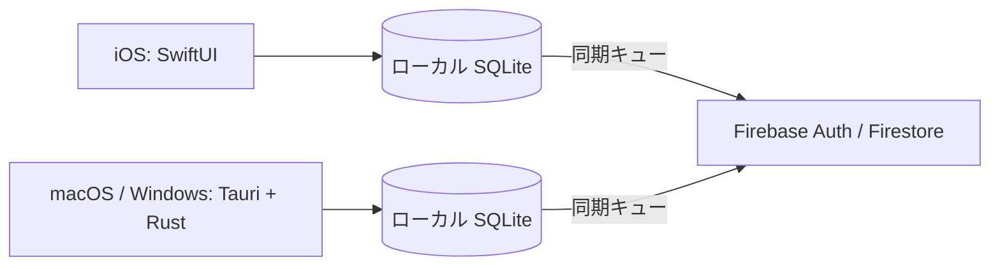

# DevTrack

開発時間を記録・同期・分析するiOS、macOS、Windows向けアプリの開発プロジェクトです。現在は開発中です。iOSにローカルのプロジェクト管理とタイマーの試作があります。同期・分析などは未実装です。

## 計画している機能

- iOSでの手動タイマー、プロジェクト管理、履歴、分析、ウィジェット
- macOS・Windowsでの対象作業の自動計測と放置時間の確認
- オフライン記録と復帰後のユーザー単位の同期

## 構成と技術



SQLiteを各端末の記録の正本とし、変更と送信キューを同じトランザクションで保存する設計です。UUIDによる冪等な操作、バージョン検証、論理削除、競合の保持を予定しています。重複区間は元データを保持したまま集計時に調整します。これらは設計であり、実装・検証は今後行います。

自動計測は対象アプリの前面状態・操作状態・プロジェクト判定を組み合わせる予定です。ロックやスリープ中は計上せず、放置時間は確認待ちにします。ブラウザ情報は許可された対象に限定します。

Firebase UIDによる分離、Firestore Security Rules、OSの資格情報ストア、PCのOAuthとPKCEを前提に設計します。管理者秘密鍵をアプリに組み込みません。プロフィールと削除時のアクセス制御をエミュレータで検証しています。

## 開発と検証

現段階の基盤チェックはPython 3標準ライブラリのみで実行できます。

```sh
python3 -m unittest discover -s tests -v
python3 scripts/check_foundation.py
```

iOSのビルドにはXcode、デスクトップ開発にはRust、Node.jsおよび各OS向けTauri 2の前提環境が必要です。アプリのビルド手順は実装時に追加します。

仕様は [docs/SPEC.md](docs/SPEC.md)、構成は [docs/ARCHITECTURE.md](docs/ARCHITECTURE.md)、計画と検証状況は [docs/DEVELOPMENT_PLAN.md](docs/DEVELOPMENT_PLAN.md) と [docs/PROGRESS.md](docs/PROGRESS.md) を参照してください。画面は未実装のためスクリーンショットはありません。AI支援を利用して開発しています。

## Firebaseエミュレータ検証

Node.js 24とJava 21を用意し、以下を実行します。実Firebaseプロジェクトではなく `demo-devtrack` とローカルエミュレータを使用します。

```sh
npm ci
npm run test:emulator
```

iOSシミュレータとmacOSで実Googleアカウントのログインを確認しています。iOS実機・Windowsは未検証です。Firestoreルールはユーザープロフィールのみ許可し、他のパスを拒否します。実Firebaseプロジェクトに適用済みです。Firestore等を含む完全なアカウント削除は未実装です。

認証と削除機能の開発状況、Firebaseのセットアップ状況は [docs/FIREBASE_SETUP.md](docs/FIREBASE_SETUP.md) を参照してください。iOS実機・WindowsでのGoogleログインの検証と、アカウントの完全削除は未完成です。
